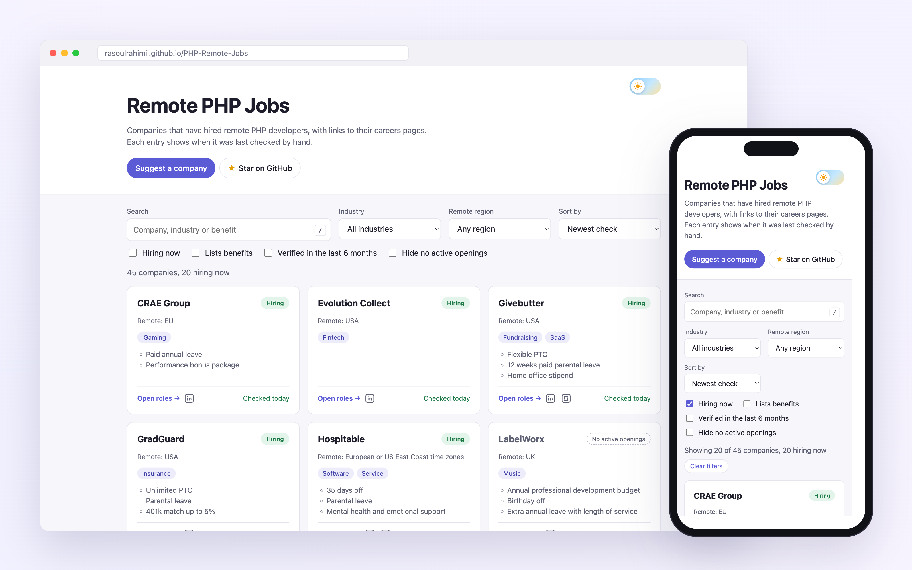
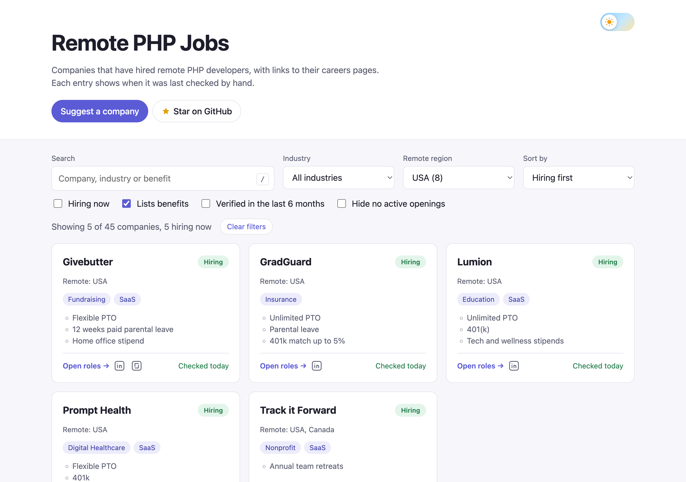

# Remote PHP Jobs

**A hand-checked list of companies that hire remote PHP developers.** 
Laravel, Symfony, WordPress, Magento, Drupal and plain PHP, verified on each company's own careers page.

 

<a href="https://rasoulrahimii.github.io/PHP-Remote-Jobs/">
  <picture>
    <source media="(prefers-color-scheme: dark)" srcset="docs/images/hero-dark.png">
    
  </picture>
</a>

 

## Why this list

Job boards are full of reposted, expired and agency listings. This list only contains companies that **hire PHP developers directly** and **let them work remotely**. Each entry links to the company's own careers page and records the date someone last checked it by hand.

<table>
  <tr>
    <td width="33%" valign="top">
      <h3>✅ Direct employers</h3>
      No recruiting agencies, staffing firms or talent marketplaces. You apply to the company that will employ you.
    </td>
    <td width="33%" valign="top">
      <h3>🌍 Remote only</h3>
      Fully remote, or remote within a region such as the EU or USA. Hybrid and office-based roles are not listed.
    </td>
    <td width="33%" valign="top">
      <h3>🔍 Checked by hand</h3>
      Every entry is verified against a real PHP job posting and shows when it was last checked.
    </td>
  </tr>
</table>

## How to use the site

Open **[rasoulrahimii.github.io/PHP-Remote-Jobs](https://rasoulrahimii.github.io/PHP-Remote-Jobs/)**. It works on desktop and mobile, in light and dark mode, and needs no account.

1. **Narrow it down to where you live.** Use **Remote region** to keep only companies that hire in your country or region, such as `EU`, `UK` or `USA`. "No region limit listed" shows companies whose roles have no stated location restriction.
2. **Show who is hiring right now.** Tick **Hiring now**, or sort by **Hiring first** to see open roles at the top while keeping the rest of the list.
3. **Search and filter.** Search by company name, industry or benefit (press <kbd>/</kbd> to jump to the search box). Filter by **Industry**, or keep only companies that **list benefits** or were **verified in the last 6 months**.
4. **Open the roles.** Click **Open roles →** on a card to go straight to the company's careers page. The icons next to it open the company's LinkedIn jobs page and, where available, its Glassdoor reviews.
5. **Share or bookmark your search.** Every filter is stored in the address bar, so a link such as [`?region=USA&sort=hiring`](https://rasoulrahimii.github.io/PHP-Remote-Jobs/?region=USA&sort=hiring) opens with the same results. **Clear filters** takes you back to the full list.

  <picture>
    <source media="(prefers-color-scheme: dark)" srcset="docs/images/filtered-dark.png">
    
  </picture>
  
Companies that hire remotely in the USA and list their benefits, sorted with open roles first.

### Reading a company card

| On the card | What it means |
|---|---|
|  | A remote PHP role was open on the company's careers page when it was last checked. |
|  | The company hired remote PHP developers within the last 12 months but had nothing open at the last check. Worth watching. |
| **Remote: EU** | The role is remote but limited to this region. No line means no region limit was listed. |
| **Checked 3 days ago** | When the entry was last verified by hand. Hover over it to see the exact date. It turns orange after 6 months. |

> [!TIP]
> Statuses are a snapshot from the last check. Always confirm the role, location and requirements on the company's own careers page before you apply.

## Contributing

Know a company that hires remote PHP developers? Make sure it meets the [inclusion criteria](CONTRIBUTING.md#inclusion-criteria): it is the direct employer, it posted a remote role that requires PHP in the last 12 months, and it has a working careers page. Then either:

- **[Suggest it in an issue](https://github.com/rasoulrahimii/PHP-Remote-Jobs/issues/new?template=suggest-company.yml)**, no code needed, or
- **add it to [`companies.yml`](companies.yml)** in a pull request and run `php scripts/companies.php validate`.

Found a dead link or a company that stopped hiring? **[Report a problem](https://github.com/rasoulrahimii/PHP-Remote-Jobs/issues/new?template=report-problem.yml)**. Re-checking entries that have not been verified for a while is a great first contribution. See [CONTRIBUTING.md](CONTRIBUTING.md) for details.

The website is generated from `companies.yml` and published automatically to GitHub Pages whenever the list changes.

## More places to find PHP jobs

<b>Framework job boards</b>

 

- **[Symfony Jobs](https://symfony.com/jobs)**
- **[LaraJobs](https://larajobs.com/)** for Laravel

<b>Remote job boards</b>

 

| | | |
|---|---|---|
| [We Work Remotely](https://weworkremotely.com/) | [Remote OK](https://remoteok.io/) | [FlexJobs](https://www.flexjobs.com/) |
| [Wellfound](https://wellfound.com/jobs) | [Remotive](https://remotive.io/) | [Jobspresso](https://jobspresso.co/) |
| [Working Nomads](https://www.workingnomads.co/) | [Remote.co](https://remote.co/) | [SkipTheDrive](https://www.skipthedrive.com/) |
| [Remote Rocketship](https://www.remoterocketship.com/) | | |

<b>LinkedIn, Glassdoor and Upwork</b>

 

On [LinkedIn](https://www.linkedin.com/jobs), [Glassdoor](https://www.glassdoor.com/Job/index.htm) and [Upwork](https://www.upwork.com/), search for PHP, Laravel or Symfony and apply the **remote** filter.

## Disclaimer

Companies on this list may also hire for other stacks, and each one had at least one remote PHP opening at some point in the last 12 months. The list does not show real-time openings, so check each careers page for the latest roles.

 

If this list helped you, please **[give it a ⭐ on GitHub](https://github.com/rasoulrahimii/PHP-Remote-Jobs)** so more PHP developers can find it.

Released under the [MIT License](LICENSE).

